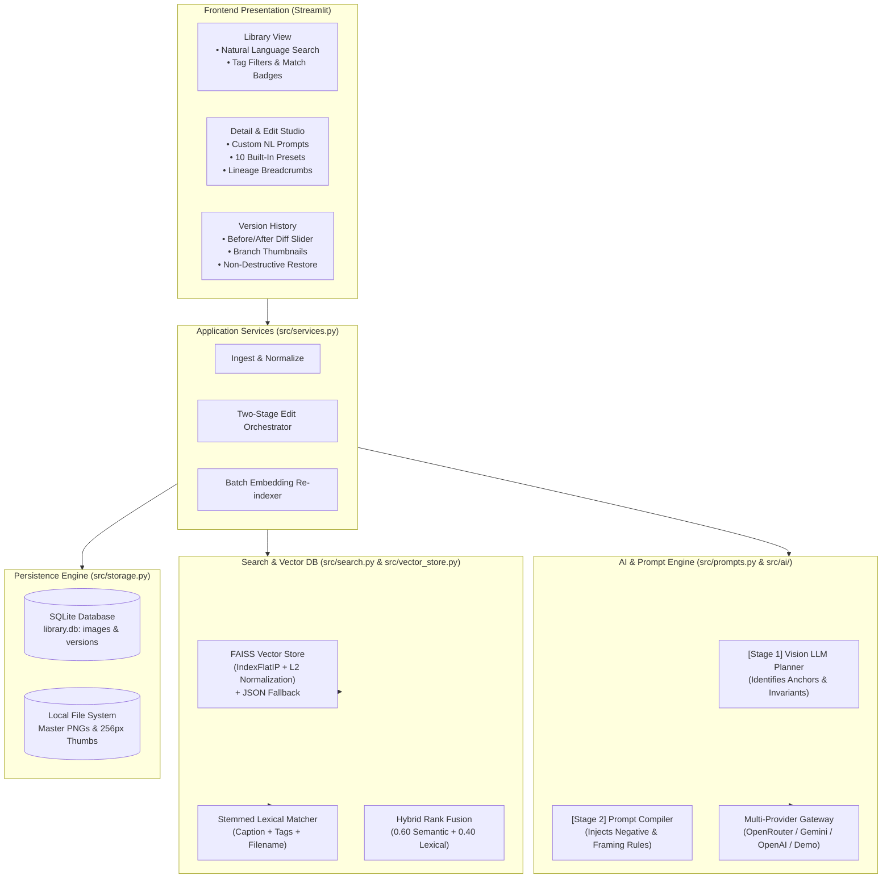

# PromptCanvas Architecture & Engineering Specification

## 1. High-Level System Architecture

PromptCanvas is built with a decoupled 4-tier architecture designed for low-latency visual interaction, resilient AI provider connectivity, and non-destructive image version management.



---

## 2. Component Breakdown

### A. Presentation Tier (`app.py`)
* **Framework**: Streamlit 1.67+ with responsive multi-column layouts and custom CSS badges.
* **Smart Search Bar**: Supports three search engine modes:
  * **Hybrid (FAISS + Keyword)**: Default production mode combining vector similarity with exact keyword recall.
  * **Semantic Only (FAISS)**: Pure dense embedding vector search for high conceptual recall (e.g. *"peaceful nature"*).
  * **Keyword Only (Lexical)**: Fast substring and tokenized stemmer match for filenames and tags.
* **Lineage Tracker**: Shows the provenance chain for any version: `Original → v1 (Remove Background) → v2 (Golden Hour)`.
* **Execution Telemetry**: Surfaces image resolution (`width × height`), file size, and AI model execution latency (`duration_ms`).

### B. Two-Stage Edit Pipeline (`src/prompts.py` & `src/services.py`)
1. **User Request**: e.g., *"Remove the guy on the left"*.
2. **Stage 1 (Vision Planner)**: A Vision LLM (`gemini-2.5-flash` or `gpt-4o-mini`) inspects the raw image bytes and user text, returning structured JSON:
   ```json
   {
     "edit_type": "remove",
     "instruction": "Remove the man wearing the red jacket on the left side of the frame",
     "preserve": "the woman seated at the table, foreground cups, and background cafe facade"
   }
   ```
3. **Stage 2 (Prompt Compiler)**: Wraps the instruction with domain-specific rules (lighting consistency, grain matching, no watermarks or text distortion).
4. **Execution & Re-indexing**: Generative image model executes the edit; the resulting PNG is normalized, stored as a new version node, and automatically re-captioned and re-indexed.

### C. Vector Database & Search (`src/vector_store.py` & `src/search.py`)
* **Vector Store Core**:
  * **FAISS (`faiss-cpu`)**: Employs `IndexFlatIP` combined with L2 vector normalization to calculate exact cosine similarities in sub-millisecond time.
  * **JSON Fallback**: If FAISS is unavailable, automatically switches to a vectorized NumPy / JSON persistence format without breaking API contracts.
  * **Persistence**: Synchronizes vector arrays into `data/vector_index.faiss` and metadata into `data/vector_meta.json`.
* **Hybrid Score Formulation**:
  $$\text{Score} = 0.40 \times \text{LexicalOverlap} + 0.60 \times \text{CosineSimilarity}$$

### D. Relational Schema & Storage (`src/storage.py`)
* **Database**: SQLite (`data/library.db`) with foreign key constraints enabled.
* **Schema Definition**:
  ```sql
  CREATE TABLE images (
      id TEXT PRIMARY KEY,
      name TEXT NOT NULL,
      caption TEXT NOT NULL DEFAULT '',
      tags TEXT NOT NULL DEFAULT '[]',
      embedding TEXT,
      created_at TEXT NOT NULL,
      original_version_id TEXT NOT NULL,
      current_version_id TEXT NOT NULL,
      width INTEGER NOT NULL DEFAULT 0,
      height INTEGER NOT NULL DEFAULT 0
  );

  CREATE TABLE versions (
      id TEXT PRIMARY KEY,
      image_id TEXT NOT NULL REFERENCES images(id) ON DELETE CASCADE,
      version_no INTEGER NOT NULL,
      parent_id TEXT,
      kind TEXT NOT NULL,
      prompt TEXT NOT NULL DEFAULT '',
      refined_prompt TEXT NOT NULL DEFAULT '',
      provider TEXT NOT NULL DEFAULT '',
      file_path TEXT NOT NULL,
      thumb_path TEXT NOT NULL,
      created_at TEXT NOT NULL,
      width INTEGER NOT NULL DEFAULT 0,
      height INTEGER NOT NULL DEFAULT 0,
      file_size INTEGER NOT NULL DEFAULT 0,
      duration_ms REAL NOT NULL DEFAULT 0.0
  );
  ```

---

## 3. Error Handling Architecture (`src/exceptions.py`)

All platform exceptions derive from a unified base class to allow clean user-facing error reporting without raw unhandled stack traces:

* `PromptCanvasError`: Base class (inherits from `ValueError` for backward compatibility).
  * `ImageValidationError`: Malformed bytes, unsupported formats, or corrupt headers.
  * `ImageNotFoundError`: Non-existent image record requested.
  * `VersionNotFoundError`: Non-existent or mismatched version node requested.
  * `StorageError`: SQLite transaction failure or disk I/O bottleneck.
  * `SearchError`: Vector dimension mismatch or query compilation error.
